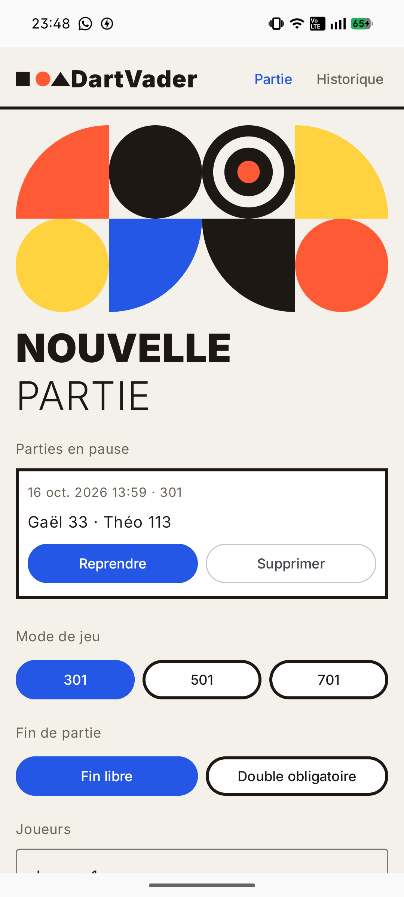
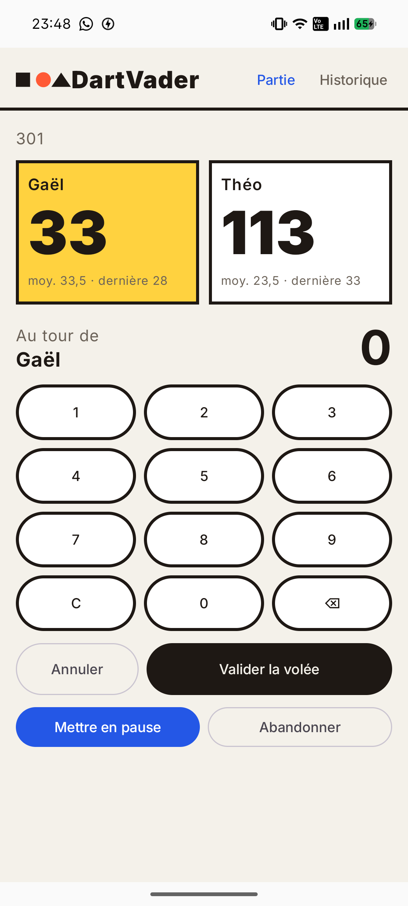
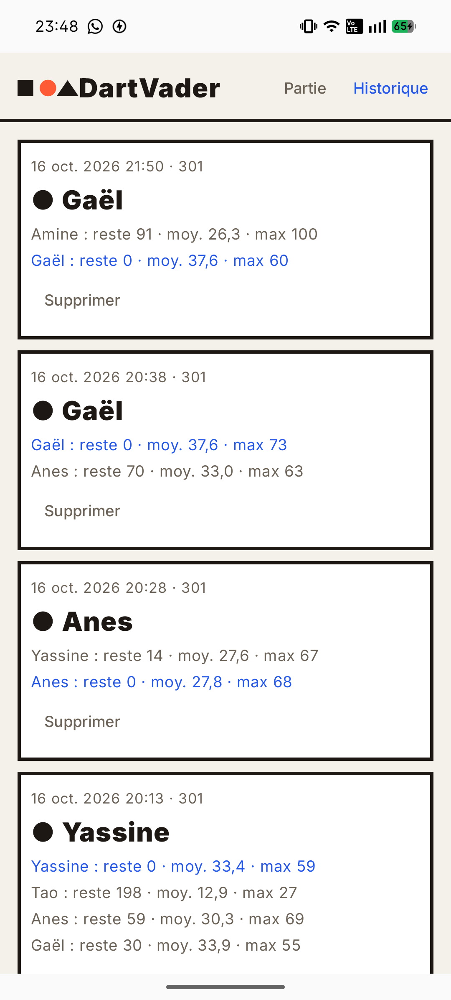

# DartVader

**DartVader** is a modern Android dart scoring application built with **Jetpack Compose** and designed with a unique visual identity inspired by the **Bauhaus** design movement.

---

## Design & Bauhaus Style
The app features a striking architectural and geometric aesthetic:
- Strict geometric shapes (rectangles, circles, custom Canvas composition).
- High-contrast color palette (Ink, Brass Blue, Red, Yellow).
- Bold, heavy typography (`FontWeight.Black`).
- Clean interface with uncompromising ergonomics.

---

## Features
- **Game Modes**: 301, 501, and 701 points.
- **End-Game Rules**: Free finish or Double out required.
- **Multiplayer**: Support for up to 8 players with customizable names.
- **Paused Games Management**: Pause ongoing games, resume them later, or delete them.
- **History & Statistics**: Track finished matches, view leg averages, best scores, and winners.
- **Virtual Keyboard Support**: Automatic IME inset handling (the software keyboard never obscures input fields).

---

## Screenshots

| Setup Screen | Game Screen | History Screen |
| :---: | :---: | :---: |
|  |  |  |

---

## Tech Stack
- **UI**: Jetpack Compose & Material 3
- **Architecture**: State hoisting, Local SharedPreferences persistence
- **Language**: Kotlin
- **Min SDK**: API 26 (Android 8.0+)
- **Target SDK**: API 35 (Android 15)

---

## Setup & Build
1. Clone the repository:
   ```bash
   git clone https://github.com/moonlight58/dartvader.git
   ```
2. Open the project in **Android Studio**.
3. Sync Gradle dependencies and run the app on an emulator or physical device (API 26+).

---

## License
This project is open-source and available under the MIT License.
